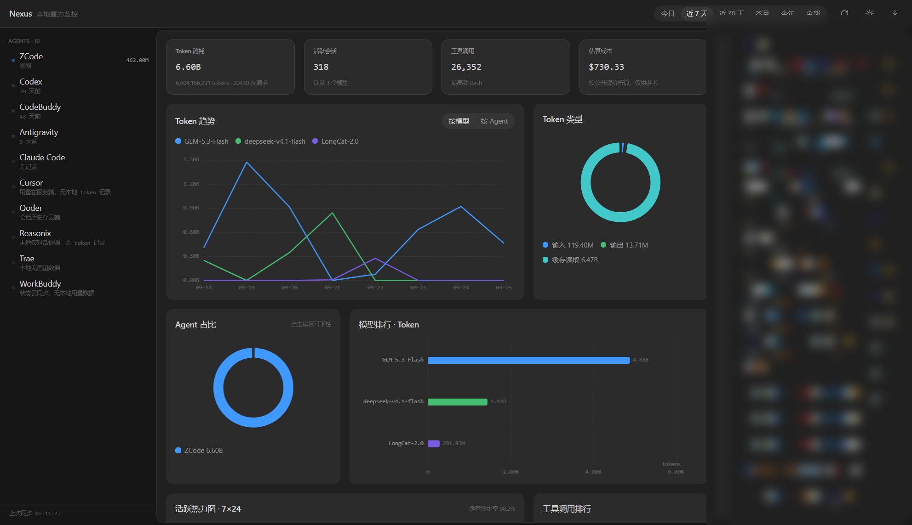
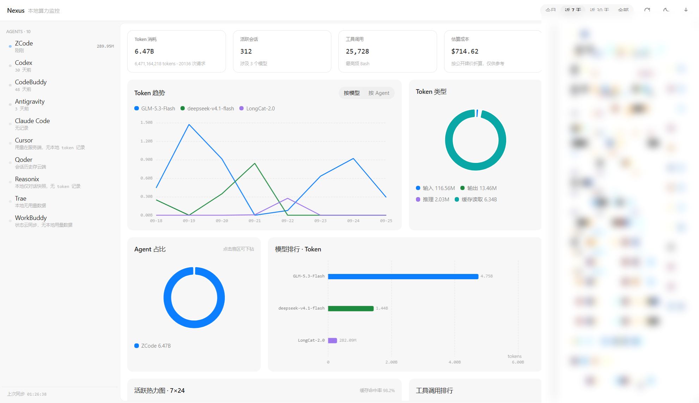

# Nexus — 本地 AI Agent 算力监控中心

   

> 「重度 token 消耗 ≈ AI 编程能力跃迁的必要过程；用量是这段经历的计量学证据——**你烧过的 token 就是你升级的台阶**。」
>
> 「**百亿 tokens 俱乐部的成员缺的不是算力，是一台里程表——Nexus 就是 AI 编程重度用户的里程表：把你烧过的每一个 Agent 的每一个 token 变成可回看、可证明、可复盘的资产。**」

一个本地优先的、单一窗口的桌面应用：读取本机各 AI Agent 的本地日志/数据库与官方用量接口，把 Token 消耗、真实花费、会话、工具调用汇总成一块精美看板。**纯监控，零干预**——不改任何 Agent 的配置，不干预任何 Agent 的运行。

## 为什么是 Nexus：百亿 tokens 俱乐部需要一台里程表

当社区开始讨论"重度 token 使用与编程能力跃迁的因果关系"时，第一件事是——**你的用量在哪？**

现实是：多数 Agent 本地只保留 30 天滚动窗口。你烧掉的 token，两周前就已经从日志里消失，成为这段成长经历里**没有凭证的传闻**。想复盘"我是怎么走到今天的"，答案永远是查无此人。

Nexus 的回答：**在你烧的时候，就把它变成资产。** 首次同步即把全量历史快照进自有库，此后增量追加——从今天起，你的每一亿 token 都有账可查、有图可看、有单可对。



## 570 亿 tokens 的真实环境里生长出来

这不是一个对着示例数据开发的玩具。以下数字来自本工具作者本人的真实使用环境（2026-11-06 实测）：

| 实拍指标 | 数值 |
| --- | --- |
| 累计 Token 消耗 | **570.5 亿**（57,048,538,655） |
| 会话 | 1,317 |
| 工具调用 | 13.59 万 |
| 模型 | 35 个 |
| 有精确数据的 Agent | 8 个 |

**先有重度使用，才有工具**——每一个数据源接入方案，都是在真实海量数据上撞出来的。



## 承认先例，划清差异

**ccusage 开创了 Claude Code 用量统计**——它对 Claude Code 单一生态的统计深度（daily/monthly/blocks、成本计算成熟度）至今仍是同类标杆，值得每一个用量工具学习。

Nexus 补上了它们没做的三件事：

1. **中国系 Agent 全覆盖** —— ZCode / CodeBuddy（国内+国际版）/ DeepSeek Harness / WorkBuddy / Reasonix 等；其中 CodeBuddy 的用量维度，目前没有任何同类工具覆盖
2. **快照式永久历史** —— 多数 Agent 本地仅留 30 天，Nexus 首次同步即全量历史照进自库，此后增量追加，永不丢失
3. **桌面单文件形态** —— 双击 exe 即用，无后端、无浏览器、无部署

### 与同类工具的诚实对比

| 维度 | ccusage 及同类 CLI | 各 Agent 官方仪表盘 | **Nexus** |
| --- | --- | --- | --- |
| Agent 覆盖 | Claude Code（深度） | 各家只看自己 | **10 个 Agent 统一看板**，中国系全覆盖 |
| 历史留存 | 依赖 Agent 本地数据（30 天滚动，过时不候） | 云端留存，出过事故 | **快照式永久本地历史** |
| 形态 | CLI / npm 包 | 网页 | **单 exe 桌面看板**（无后端无浏览器） |
| 成本视角 | API 牌价估算 | 平台账单 | **等效估算（明确标注）+ 官方账单对账** |
| 隐私 | 本地运行 | 数据在云端 | **一切留在本机，只读模式** |
| 语言 | 英文 | 各家不一 | **中文优先** |

> ccusage 的历史数据可导入规划已在路线图中（生态兼容优先级最高的接口）。

## 核心特性

- **单一软件形态**：双击一个 exe → 一个窗口，无需启动后端、无需打开浏览器。
- **快照式留存**：各 Agent 本地用量表普遍只保留有限天数，Nexus 首次同步即把全量历史快照进自有库，此后增量追加，**历史永不丢失、永久本地**。
- **账号级真实消耗**：直连平台官方用量接口，回溯账号全历史 Token 与真实花费（¥/$），与官网账单逐条对账一致；应用内独立账号配额面板，不与看板混排。
- **平台登录**：区分国内版 / 国际版入口，普通 / 无痕两种登录方式，凭据仅存本机。
- **数据维度**：请求级输入/输出/推理/缓存读写 Token、会话、工具调用、按模型/Agent/厂商拆分、等效 API 成本估算（UI 明确标注"估算"）+ 官方账单实付。
- **看板**：KPI 卡、按模型/Agent 的 Token 趋势（分组可切换）、7×24 活跃热力图、每日强度、Agent 占比环形图（点击下钻）、模型/工具排行、会话明细（敏感信息一键遮罩）、时间范围切换（今日/近 7 天/近 30 天/全部/**自定义——精确到分钟**）、暗/亮主题、看板导出 PNG。
- **侧栏双分类**：Agent / 厂商两种视图切换，全部使用各平台官方 Logo。
- **多开感知**：ZCode 等支持多实例并存的应用，侧栏直接透出存活实例数。
- **性能**：单遍聚合 + 看板缓存预热，13 万+ 用量记录下切换时间范围/Agent 依然即时响应。
- **隐私**：一切数据留在本机；读取用户 Agent 数据库时一律只读模式；不加入任何云上报、遥测或账号体系。

## 已接入的数据源

| Agent / 平台 | 数据 | 精确度 |
| --- | --- | --- |
| ZCode | `~/.zcode/cli/db/db.sqlite`（请求级 token + 会话 + 工具调用，多实例感知） | 精确 |
| Codex | `~/.codex/sessions/**/*.jsonl`（token_count 事件） | 精确 |
| Claude Code | `~/.claude/projects/**/*.jsonl` | 精确（产生数据即生效） |
| Antigravity | 会话元数据 + Antigravity Cockpit 代理日志（若启用） | 精确（启用后） |
| CodeBuddy（国内版 / 国际版） | 本地 history 逐请求 usage + vscdb 会话关联 + 官方账单 | 精确 |
| WorkBuddy | `~/.workbuddy-ai` 转录 + traces + 本地库 | 精确 |
| Reasonix | stats 每日 jsonl | 精确 |
| OpenCode | `opencode.db` | 精确 |
| DSH（DeepSeek Harness） | 会话多帧 zstd 档案逐帧解压（含 per-model 细分与压缩上下文用量） | 精确 |
| DeepSeek 官方平台 | usage API 全历史分段滚动回溯 | 精确（与官网对账一致） |
| Qoder / Trae / Cursor | 本地无结构化 token 数据（见调研报告） | 仅感知安装状态 |

详见 `docs/research/agent-datasource-report.md`。

## 路线图

- [ ] ccusage JSONL 历史导入（从竞品零成本迁移）
- [ ] macOS 支持（当前 Windows 优先，目标用户画像重合）
- [ ] Demo 数据动图

## 开发

```bash
npm install        # Node 22+（Electron 41 内含 node:sqlite）
npm run dev        # 开发模式（热重载）
npm run typecheck  # 双 tsconfig 类型检查
npm run build      # 构建主进程/preload/渲染层到 out/
npm run dist       # electron-builder 打包 NSIS 安装版 + 便携版
```

### 验证工具

```bash
npx electron out/main/smoke.js   # 冒烟：真实同步全部适配器 + 全量查询自检
NEXUS_DEBUG=1 npm run dev        # 转发渲染进程 console 到终端
```

## 架构

模块化单体（Electron 主进程），`transport(IPC) → application → domain ← infrastructure`，domain 零外部依赖；渲染层 React 19 + Tailwind 4 + ECharts 6，主题 Token 对标 ZCode Zai Dark。存储用 Electron 内建 `node:sqlite`（与 ZCode 同款，零原生编译）。详见 `docs/modules/`。

## 治理

- 文档同步：`docs/modules/index.md` + 各模块 md，秒级时间戳。
- 红蓝对抗审计：AI 子代理循环审计直至通过，结论见 `docs/reports/PROJECT_LAUNCH_REPORT.md`。
- License：[MIT](LICENSE)。

---

**牛码 & jayc-labs 出品**

> 你的 Agent 用量也可以被守护：[ApiSpace](https://github.com/xiaotaoya2022-cell/nexus#) <!-- TODO(PO): 替换为 ApiSpace 注册 aff 链接（InviterId 归因） -->
