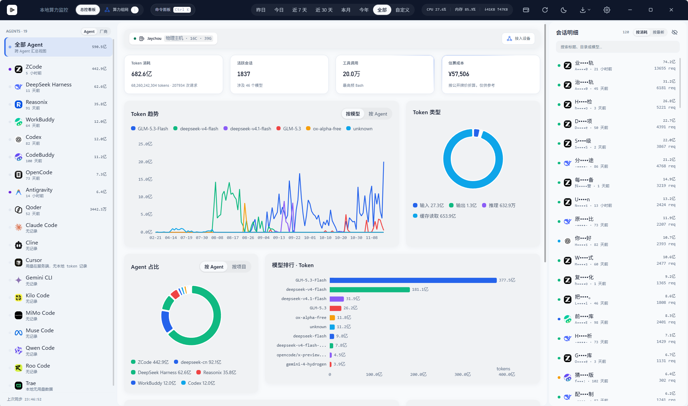

<div align="center">
  
  <h1>Nexus</h1>
  <p><strong>本地 AI Agent 算力监控中心</strong></p>
  <p><em>万千 Token，汇于一处；每一次消耗，皆有记录。</em><br/>
  <sub>EVERY TOKEN FINDS ITS RECORD. ｜ 品牌理念：聚合 · 计量 · 留存 · 追溯</sub></p>
  <p>
    
    
    
    
  </p>
</div>

> 「重度 token 消耗 ≈ AI 编程能力跃迁的必要过程；用量是这段经历的计量学证据——**你烧过的 token 就是你升级的台阶**。」
>
> 「**百亿 tokens 俱乐部的成员缺的不是算力，是一台里程表——Nexus 就是 AI 编程重度用户的里程表：把你烧过的每一个 Agent 的每一个 token 变成可回看、可证明、可复盘的资产。**」

一个本地优先的、单一窗口的桌面应用：读取本机各 AI Agent 的本地日志/数据库与官方用量接口，把 Token 消耗、真实花费、会话、工具调用汇总成一块精美看板。**纯监控，零干预**——不改任何 Agent 的配置，不干预任何 Agent 的运行。

## 为什么是 Nexus：百亿 tokens 俱乐部需要一台里程表

当社区开始讨论"重度 token 使用与编程能力跃迁的因果关系"时，第一件事是——**你的用量在哪？**

现实是：多数 Agent 本地只保留 30 天滚动窗口。你烧掉的 token，两周前就已经从日志里消失，成为这段成长经历里**没有凭证的传闻**。想复盘"我是怎么走到今天的"，答案永远是查无此人。

Nexus 的回答：**在你烧的时候，就把它变成资产。** 首次同步即把全量历史快照进自有库，此后增量追加——从今天起，你的每一亿 token 都有账可查、有图可看、有单可对。



## 680 亿 tokens 的真实环境里生长出来

这不是一个对着示例数据开发的玩具。以下数字来自本工具作者本人的真实使用环境（2026-11-15 实测）：

| 实拍指标 | 数值 |
| --- | --- |
| 累计 Token 消耗 | **682.6 亿**（68,260,242,304） |
| 会话 | 1,837 |
| 工具调用 | 20.0 万 |
| 模型 | 46 个 |
| 实机累计有数据的 Agent | 9 个（共适配 19 个） |

**先有重度使用，才有工具**——每一个数据源接入方案，都是在真实海量数据上撞出来的。


## 一块看板，补齐生态空白

Nexus 补上了市面上工具没做的三件事：

1. **中国系 Agent 全覆盖** —— ZCode / CodeBuddy（国内+国际版）/ DeepSeek Harness / WorkBuddy / Reasonix / Qoder 等，均基于实机数据格式与官方接口原生解析
2. **快照式永久历史** —— 多数 Agent 本地仅留 30 天，Nexus 首次同步即全量历史照进自库，此后增量追加，永不丢失
3. **纯本地免部署形态** —— 提供 Windows NSIS 安装版与单文件便携 exe，无后端、无浏览器，开箱即用

### 能力维度

| 维度 | CLI 统计工具 | 各 Agent 官方仪表盘 | **Nexus** |
| --- | --- | --- | --- |
| Agent 覆盖 | 多聚焦单一生态 | 各家只看自己 | **19 个 Agent 统一看板**（17 个本地解析适配器 + 2 个安装感知 / 10 平台配额集成），中国系全覆盖 |
| 历史留存 | 依赖 Agent 本地数据（30 天滚动，过时不候） | 云端留存 | **快照式永久本地历史** |
| 形态 | 命令行 / 需部署 | 网页 | **Windows 安装包 / 单 exe 便携版 + Android 扫码伴侣**（桌面端无后端无浏览器） |
| 成本视角 | API 牌价估算 | 平台账单 | **等效估算（明确标注）+ 官方账单对账** |
| 额度视角 | — | 网页逐家查看 | **10 平台账号配额快照与阈值告警**（如 Antigravity 周/5h 窗口、Codex / Cursor / CodeBuddy 等） |
| 隐私 | 本地运行 | 数据在云端 | **一切留在本机，只读模式** |
| 语言 | 多为英文 | 各家不一 | **中文 / English 双语，即时切换** |

## 核心特性

- **多端免部署形态**：Windows 桌面提供 NSIS 安装版与单文件便携 exe，无需启动后端、无需打开浏览器；配套 Android apk 扫码即连桌面快照与配额。
- **快照式留存**：各 Agent 本地用量表普遍只保留有限天数，Nexus 首次同步即把全量历史快照进自有库，此后增量追加，**历史永不丢失、永久本地**。
- **账号级真实消耗**：直连平台官方用量接口，回溯账号全历史 Token 与真实花费（¥/$），与官网账单逐条对账一致；应用内独立账号配额面板，不与看板混排。
- **平台登录**：区分国内版 / 国际版入口，普通 / 无痕两种登录方式，凭据仅存本机。
- **数据维度**：请求级输入/输出/推理/缓存读写 Token、会话、工具调用、按模型/Agent/厂商拆分、等效 API 成本估算（支持设置内公开牌价与币种校准）+ 官方账单实付。
- **看板与交互**：KPI 卡、按模型/Agent 的 Token 趋势（分组可切换）、7×24 活跃热力图、每日强度、Agent 占比与项目下钻环形图、模型/工具排行、会话明细抽屉（Session Inspector + 敏感信息一键遮罩）、`Ctrl+K` 命令面板、时间范围切换（今日/昨日/近 7 天/近 30 天/本月/今年/全部/**自定义——精确到分钟**）、暗/亮主题、多格式导出中心（PNG 高清长图 / CSV 对账表 / Markdown 报告 / JSON 快照）。
- **侧栏双分类**：Agent / 厂商两种视图切换，全部使用各平台官方 Logo。
- **双界面风格与高可读排版**：**Porcelain 瓷昼**（默认，源自 MEMORA 设计语言：瓷白卡片 · 细描边 · 克制柔影 · 深色收束顶栏）与 Nexus Studio，暗/亮主题全覆盖；全局统一 MEMORA「方案 A · 精密工程仪器风」字体栈（正文 Segoe UI Variable Text，数字仪表 Bahnschrift）、**13.5px 正文均值 + 18px KPI 主数字统一**，全主题强化次级文本与图表轴对比度；配备 OverlayScrollbars 全局透明细滚动条、六态弹簧自定义鼠标（含远控防锁防飘优化）与多 DPI / Windows 任务栏明暗自适应托盘位图。
- **双语界面**：中文 / English 即时切换（设置面板），数字量级单位随语言自适应（万/亿 ↔ K/M/B/T），图表轴、状态、提示全覆盖。
- **多开感知**：ZCode 等支持多实例并存的应用，侧栏直接透出存活实例数。
- **远程访问**：内置局域网 WebSocket（WS）服务，手机扫码配对后实时查看看板快照与账号配额（配对密钥挑战派生签名鉴权，令牌永不上线）；跨网经内嵌 Tailscale 引擎（tsnet sidecar）加密隧道直连，配对地址可按网络环境选择。
- **移动端**：Android apk（Capacitor 复用 PC 端协议与类型），扫码配对即用。
- **算力组网（Mesh）**：多机节点聚合采集——WSL2 / Linux 无头节点经 `--pair` 信箱配对增量推送，实机/虚机拓扑可视化；配对与连接链路带私网断言与 SSRF 门禁。
- **账号与配额引擎**：应用内 OAuth 登录（Codex PKCE 回环 / CodeBuddy 国内版 / WorkBuddy / Qoder 设备码）、本地凭据导入（Cursor 等）、5 分钟轮询配额快照与阈值告警（70/80/90/95% 可配，系统通知 + 远程推送）。
- **性能**：单遍聚合 + 看板缓存预热 + 看板全切片签名门控（无变化刷新零重绘），20 万+ 请求记录下切换时间范围/Agent 依然即时响应，60s 周期刷新在数据无变化时不产生任何图表重建；刷新窗口自动归还系统光标 + 卡顿看门狗兜底，监控不卡鼠标。
- **隐私**：一切数据留在本机；读取用户 Agent 数据库时一律只读模式；不加入任何云上报、遥测或账号体系。

## 已接入的数据源

| Agent / 平台 | 数据 | 精确度 |
| --- | --- | --- |
| ZCode | `~/.zcode/cli/db/db.sqlite`（请求级 token + 会话 + 工具调用，多实例感知） | 精确 |
| Codex | `~/.codex/sessions/**/*.jsonl`（token_count 事件） | 精确 |
| Claude Code | `~/.claude/projects/**/*.jsonl` | 精确（产生数据即生效） |
| Antigravity | 本地 `transcript.jsonl` / `conversations/*.db` Protobuf `gen_metadata` + Cockpit 请求日志，加周 / 5 小时窗口官方配额快照与消耗趋势 | 精确（含本地模型级 token 与云端额度） |
| CodeBuddy（国内版 / 国际版） | 本地 history 逐请求 usage + vscdb 会话关联 + 官方账单与额度 | 精确 |
| WorkBuddy | `~/.workbuddy-ai` 转录 + traces + 本地库 + 云端配额/账单 | 精确 |
| Reasonix | stats 每日 jsonl | 精确 |
| OpenCode | `opencode.db` | 精确 |
| DSH（DeepSeek Harness） | 会话多帧 zstd 档案逐帧解压（含 per-model 细分与压缩上下文用量） | 精确 |
| MiMo Code（小米） | `~/.local/share/mimocode/mimocode.db`（OpenCode 同构 SQLite，逐消息 token + 成本，兼容渠道分库） | 精确 |
| Muse Code（Meta） | `~/.local/share/muse/sessions/**/session.jsonl`（逐请求 usage 事件，子集口径归一） | 精确 |
| Cline / Roo Code / Kilo Code | VS Code `globalStorage` 逐任务 `ui_messages.json`（api_req_started 的 tokensIn/Out + 缓存读写） | 精确 |
| Gemini CLI | `~/.gemini/tmp/*/chats/*.json`（逐消息 tokens，cached 子集归一） | 精确 |
| Qwen Code（通义千问 CLI） | `~/.qwen/projects/*/chats/*.jsonl`（usageMetadata，语义同 Gemini） | 精确 |
| DeepSeek 官方平台 | usage API 全历史分段滚动回溯 | 精确（与官网对账一致） |
| Cursor | 本地 state.vscdb 凭据导入 + 官方 usage-summary 云端配额（会话过期等真实状态如实提示） | 额度精确（token 级官方不下发本地） |
| Qoder | `~/.qoder*/projects` 本地 `.jsonl` + `main.sqlite`（有原始 usage 取实值，无则按轮次估算）+ 设备码云端配额 | 额度精确 / 本地混合 |
| Trae | 本地安装感知 + 配额适配器占位（待移植，无数据时保持空态） | 仅感知安装状态 |

详见 `docs/research/agent-datasource-report.md`（2026-09-24 初版基线调研；Antigravity 本地元数据与 Cursor / Qoder 配额等已在后续版本补齐）。

## 路线图

### 已完成里程碑（对照 git 历史）

- ✅ **v0.1.0** —— 看板应用落地：适配器 ×5 + `node:sqlite` 存储 + ECharts 看板，红蓝审计放行
- ✅ **v0.2.0** —— 账号级真实消耗（DeepSeek 官方账单全历史）+ 国内/国际双登录 + DSH 接入 + 无标题栏自绘窗口
- ✅ **v0.2.24** —— 15 Agent 扩面（MiMo / Muse / Cline / Roo / Kilo / Gemini / Qwen）+ i18n 双语 + 自定义时间范围 + 多开感知 + Antigravity 配额
- ✅ **v0.2.39–42** —— Nexus Mesh 算力组网 + 多格式导出中心 + 全局滚动条 / 光标修复
- ✅ **v2** —— 远程访问（局域网 WS 配对，令牌永不上线）+ Android apk + Tailscale 内嵌引擎（tsnet）+ 账号配额引擎（Codex / CodeBuddy CN / WorkBuddy / Qoder OAuth + 告警阈值 + DPAPI 链）+ VPN 内嵌入包（libwg-go.so）
- ✅ **v0.2.44–46** —— Porcelain 瓷昼主题重做（MEMORA 设计语言）+ 托盘多 DPI / 任务栏明暗自适应锐化 + 双风格字号均值统一（13.5px / 18px）与全主题对比度强化 + 刷新鼠标可用性根治 + Mesh SSRF 门禁

### 待办

- [ ] 通用 JSONL 历史导入（跨工具迁移）
- [ ] macOS 支持（当前 Windows 优先，目标用户画像重合）
- [ ] Trae 配额端点移植（`quotas/platforms/trae.ts` 当前为占位实现）
- [ ] Android VPN 内嵌开关暴露（libwg-go.so 已入包，UI 开关待接）
- [ ] ZCode 实例管理器深化（运行态进程枚举 + 无头派生）
- [ ] Demo 数据动图

## 开发

```bash
npm install        # Node 22+（Electron 41 内含 node:sqlite）
npm run dev        # 开发模式（热重载）
npm run typecheck  # 双 tsconfig 类型检查
npm run build      # 构建主进程/preload/渲染层到 out/
npm run dist       # electron-builder 打包 NSIS 安装版 + 便携版
```

### 验证工具

```bash
npx electron out/main/smoke.js   # 冒烟：真实同步全部适配器 + 全量查询自检
NEXUS_DEBUG=1 npm run dev        # 转发渲染进程 console 到终端
```

## 架构

模块化单体（Electron 主进程），`transport(IPC) → application → domain ← infrastructure`，domain 零外部依赖；渲染层 React 19 + Tailwind 4 + ECharts 6，界面主题以 **Porcelain 瓷昼（MEMORA 设计语言）** 为默认、Nexus Studio 备选，全局统一 MEMORA 方案 A 字体栈、13.5px 正文均值 / 18px KPI 主数字及全主题 AA+ 文字对比度。存储用 Electron 内建 `node:sqlite`（与 ZCode 同款，零原生编译）。v2 能力模块：远程访问 `modules/remote`（配对/鉴权/订阅推送）、账号配额引擎 `modules/quotas`（OAuth + 轮询 + 告警）、算力组网 `modules/mesh`（hub-spoke + 无头节点）、内嵌 Tailscale 引擎 `sidecars/tailscale-sidecar`（tsnet）。详见 `docs/modules/`。

## 治理

- 文档同步：`docs/modules/index.md` + 各模块 md（v0.2.46 增量变更已覆盖主入口/样式与打包说明）。
- 红蓝对抗审计：AI 子代理循环审计直至通过，初版与 v2 升级验收分别见 `docs/reports/PROJECT_LAUNCH_REPORT.md`（v0.1.0）与 `docs/reports/ENHANCEMENT_REPORT.md`（v2.0）。
- License：[MIT](LICENSE)。

---

**牛码 & jayc-labs 出品**

> 你的 Agent 用量也可以被守护：[ApiSpace](https://apispace.top)
