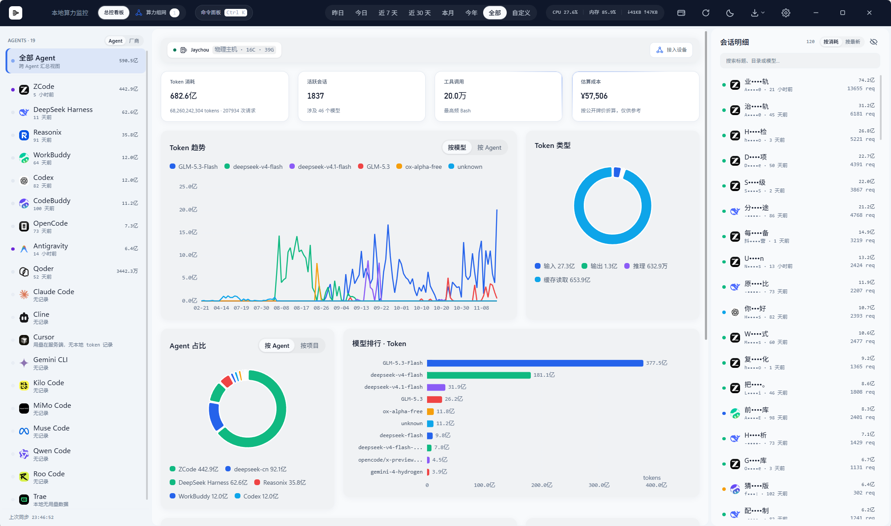
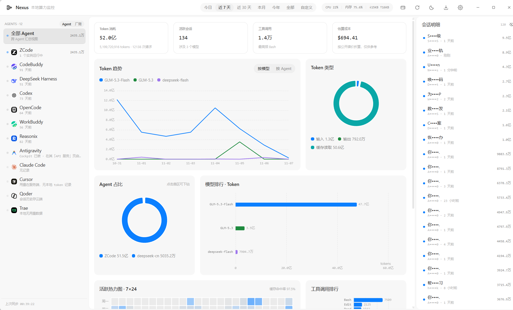

<div align="center">
  
  <h1>Nexus</h1>
  <p><strong>Local AI Agent Compute & Token Monitoring Center</strong></p>
  <p><em>Every token finds its record; every consumption is preserved.</em><br/>
  <sub>EVERY TOKEN FINDS ITS RECORD. ｜ Brand Philosophy: Aggregate · Measure · Retain · Trace</sub></p>
  <p>
    <a href="README.md">简体中文</a> ｜ <strong>English</strong>
  </p>
  <p>
    
    
    
    
  </p>
</div>

> "Heavy token consumption is the necessary path toward breakthroughs in AI engineering capabilities; usage is the metrological proof of this journey—**the tokens you burned are the stairs of your level-up.**"
>
> "**What members of the 10-billion-token club lack isn't compute, it's an odometer—Nexus is the odometer for power AI coders: turning every token burned by every Agent into an asset that can be revisited, proven, and reviewed.**"

A local-first, single-window desktop application: directly parses local logs/databases and official usage APIs across diverse AI coding agents on your machine, summarizing token consumption, actual expenditures, sessions, and tool calls into a unified, polished dashboard. **Zero interference, pure monitoring**—never alters agent configurations, never interferes with agent executions.

## Why Nexus: The 10-Billion-Token Club Needs an Odometer

When the developer community discusses the causal link between heavy token consumption and leaps in AI programming capabilities, the first question is always: **Where is your usage data?**

The reality: Most coding agents retain only a 30-day rolling window locally. Tokens you burned two weeks ago have already vanished from disk logs, turning into **unverifiable rumors** in your growth journey. When trying to review "how did I get here today," the records are lost forever.

Nexus's answer: **Turn it into an asset the moment you burn it.** On the very first synchronization, the complete history is snapshotted into an internal local database, followed by incremental append—from today on, every 100M tokens has an account to check, a chart to view, and a bill to audit.



## Grown out of a Real 68-Billion-Token Environment

This is not a toy built against mock fixtures. The figures below are captured from the author's personal real-world development workstation (measured on 2026-11-15):

| Real Workstation Metric | Value |
| --- | --- |
| Cumulative Tokens Burned | **68.26 Billion** (68,260,242,304) |
| Active Sessions | 1,837 |
| Tool Invocations | 200,000+ (20.0万) |
| Active Models | 46 |
| Agents with Historical Data | 9 (19 total supported/adapted) |

**Heavy production usage precedes the tool**—every data source parser and integration strategy was forged against massive real-world data files.



## One Dashboard, Bridging the Ecosystem Gap

Nexus bridges three critical gaps left unaddressed by existing market solutions:

1. **Complete Chinese Agent Coverage** — ZCode, CodeBuddy (Domestic + Global), DeepSeek Harness, WorkBuddy, Reasonix, Qoder, etc., natively parsed from real disk formats and official endpoints.
2. **Snapshot-Style Permanent History** — While most agents discard logs after 30 days, Nexus snapshots full history on initial sync and appends incrementally thereafter—never losing history.
3. **Pure Local, Zero-Deployment Desktop Form** — Shipped as native Windows NSIS installer and single-file portable EXE; no local server processes to start, no browser required, plug and play.

### Capability Comparison

| Dimension | CLI Aggregators | Official Web Dashboards | **Nexus** |
| --- | --- | --- | --- |
| **Agent Coverage** | Mostly single-ecosystem | Isolated vendor silos | **19 Agents unified** (17 local parsers + 2 install probes / 10 platform quota integrations), full Chinese ecosystem coverage |
| **History Retention** | Bound by agent disk retention (rolling ~30 days) | Cloud retention only | **Permanent snapshot-style local history** |
| **Form Factor** | Terminal / requires server deploy | Web browser | **Windows Installer / Portable single EXE + Android QR companion** (no browser/server required) |
| **Cost Perspective** | Public API list-price estimation | Platform billing invoice | **Equivalent estimation (clearly marked) + Official bill reconciliation** |
| **Quota Perspective** | — | Multiple separate websites | **10-platform quota snapshot & threshold alarms** (e.g. Antigravity weekly/5h window, Codex, Cursor, CodeBuddy, etc.) |
| **Privacy** | Local CLI | Data stored in vendor clouds | **100% stays on your machine, strictly read-only mode** |
| **Language** | English only | Inconsistent across tools | **Chinese / English bilingual, instant seamless toggle** |

## Core Features

- **Zero-Deployment Desktop App**: Windows desktop provides NSIS installer and standalone portable EXE; no backend services, no web browser needed. Optional companion Android APK pairs via QR code to view live snapshots and quotas.
- **Permanent Snapshot Retention**: Agent local usage tables roll over and purge older logs; Nexus snapshots full history on initial sync and appends incrementally thereafter—**data stays on your machine permanently**.
- **Account-Grade Authentic Consumption**: Directly connects to official platform usage APIs, tracing complete token history and exact expenditures (¥/$), matching official invoices item-by-item; dedicated in-app quota drawer keeps the main board clean.
- **Platform Authentication**: Supports Domestic / Global platform gateways with standard and incognito login modes; credentials remain strictly inside local secure storage.
- **Comprehensive Metrics**: Request-level input / output / reasoning / cache read-write tokens, sessions, tool invocations, breakdown by model / agent / vendor, equivalent API cost estimation (customizable price catalog & currency toggle) + actual platform invoices.
- **Dashboard & Tactile Interaction**: KPI cards, model/agent token trends (switchable grouping), 7×24 activity heatmap, daily intensity graph, agent breakdown & project drill-down donut charts, model & tool leaderboards, Session Inspector drawer with one-click sensitive info masking, `Ctrl+K` Command Palette, flexible time ranges (Today / Yesterday / 7D / 30D / This Month / This Year / All / **Custom range down to the minute**), Dark/Light themes, and multi-format Export Center (Hi-res PNG / CSV ledger / Markdown summary / JSON snapshot).
- **Dual Sidebar Classification**: Seamless toggle between Agent view and Vendor view, rendered with authentic platform vector/high-res logos.
- **Dual Design Styles & High-Readability Typography**: **Porcelain** (default, from MEMORA design language: porcelain cards, micro-borders, restrained soft shadows, dark grounding topbar) and Nexus Studio; full light/dark theme coverage. Standardized MEMORA "Scheme A: Precision Instrument" typography (Segoe UI Variable Text for prose, Bahnschrift for numeric readouts), **unified 13.5px body mean & 18px KPI value**, enhanced contrast for secondary text and chart axes; equipped with OverlayScrollbars, SurePoint adaptive pointer (with remote-desktop lock/drift prevention), and multi-DPI / taskbar-adaptive tray icons.
- **Bilingual Interface**: Instant Chinese / English switching in settings; numeric units automatically adapt (万/亿 ↔ K/M/B/T), covering chart axes, statuses, and tooltips.
- **Multi-Instance Detection**: For tools supporting concurrent instances like ZCode, the sidebar highlights live process counts in real-time.
- **Remote Access**: Built-in local WebSocket server; pair your mobile device via QR code challenge-derived signature authentication (tokens never exposed on wire); remote cross-network access supported via integrated Tailscale engine (tsnet sidecar).
- **Mobile Companion**: Android APK (Capacitor reusing desktop protocols and type definitions) for on-the-go monitoring.
- **Compute Mesh**: Distributed multi-node collection—WSL2 and headless Linux nodes push incremental batches via `--pair` mailbox tokens; topology visualization for physical and virtual machines with private-network assertions and SSRF guards.
- **Account & Quota Engine**: In-app OAuth authentication (Codex PKCE loopback / CodeBuddy CN / WorkBuddy / Qoder device code), local credential import (Cursor, etc.), 5-minute polling quota snapshots, and configurable threshold alarms (70/80/90/95% with system notifications and remote pushes).
- **High Performance**: Single-pass aggregation, cache pre-warming, and slice-level signature gating (zero redraw on no-change refreshes). Instant filtering across 200,000+ request records; 60s background refresh triggers zero chart rebuild when data is unchanged; automatic cursor yielding during refresh windows + watchdog guarantee responsiveness.
- **Privacy First**: All data remains strictly local; database reads are exclusively read-only; absolutely zero cloud reporting, telemetry, or third-party analytics.

## Supported Data Sources

| Agent / Platform | Data Source | Precision |
| --- | --- | --- |
| ZCode | `~/.zcode/cli/db/db.sqlite` (request-level tokens + sessions + tools, multi-instance aware) | Exact |
| Codex | `~/.codex/sessions/**/*.jsonl` (`token_count` events) | Exact |
| Claude Code | `~/.claude/projects/**/*.jsonl` | Exact (activates upon data generation) |
| Antigravity | Local `transcript.jsonl` / `conversations/*.db` Protobuf `gen_metadata` + Cockpit logs, plus weekly / 5-hour quota snapshots & burn trends | Exact (local model tokens + cloud quotas) |
| CodeBuddy (CN / Global) | Local history per-request usage + vscdb session correlation + official bills & quotas | Exact |
| WorkBuddy | `~/.workbuddy-ai` transcripts + traces + local DB + cloud quotas/bills | Exact |
| Reasonix | Daily stats jsonl | Exact |
| OpenCode | `opencode.db` | Exact |
| DSH (DeepSeek Harness) | Multi-frame zstd session archives unpacked frame-by-frame (per-model breakdown & compressed context) | Exact |
| MiMo Code (Xiaomi) | `~/.local/share/mimocode/mimocode.db` (OpenCode isomorphic SQLite, per-message tokens + cost) | Exact |
| Muse Code (Meta) | `~/.local/share/muse/sessions/**/session.jsonl` (per-request usage events, normalized subset) | Exact |
| Cline / Roo Code / Kilo Code | VS Code `globalStorage` per-task `ui_messages.json` (`api_req_started` tokensIn/Out + cache r/w) | Exact |
| Gemini CLI | `~/.gemini/tmp/*/chats/*.json` (per-message tokens, cached subset normalized) | Exact |
| Qwen Code (Alibaba CLI) | `~/.qwen/projects/*/chats/*.jsonl` (`usageMetadata`, Gemini semantics) | Exact |
| DeepSeek Official Platform | Usage API rolling historical traversal | Exact (matches official dashboard) |
| Cursor | Local `state.vscdb` credentials import + official `usage-summary` cloud quota (truthful session expiry alerts) | Exact Quota (tokens not cached locally by vendor) |
| Qoder | `~/.qoder*/projects` local `.jsonl` + `main.sqlite` (real usage when present, turn-based estimate fallback) + cloud quota | Exact Quota / Local Hybrid |
| Trae | Local installation detection + quota adapter placeholder | Installation state only |

See `docs/research/agent-datasource-report.md` for baseline architectural research.

## Roadmap

### Completed Milestones (Verified against Git history)

- ✅ **v0.1.0** —— Core dashboard: 5 adapters + `node:sqlite` storage + ECharts visualization, red/blue audit clearance.
- ✅ **v0.2.0** —— Account-grade consumption (DeepSeek full history) + dual CN/Global login + DSH integration + custom frameless window.
- ✅ **v0.2.24** —— Expansion to 15 agents (MiMo / Muse / Cline / Roo / Kilo / Gemini / Qwen) + i18n bilingual support + custom minute-level date range + multi-instance detection + Antigravity quota integration.
- ✅ **v0.2.39–42** —— Nexus Mesh distributed compute mesh + multi-format Export Center + global scrollbar and cursor fixes.
- ✅ **v2** —— Remote access (LAN WS pairing, token-less auth) + Android APK + Tailscale embedded engine (tsnet) + Account Quota Engine (Codex / CodeBuddy CN / WorkBuddy / Qoder OAuth + threshold alerts + DPAPI chain) + VPN packaging (`libwg-go.so`).
- ✅ **v0.2.44–46** —— Porcelain theme overhaul (MEMORA Design Language) + multi-DPI / taskbar-adaptive tray icons + unified 13.5px/18px typography mean + full-theme AA+ contrast polish + cursor watchdog + Mesh SSRF guard.
- ✅ **v0.2.47** —— Expandable panel contrast isolation (Settings/Export/Quota popovers) + topbar single-line responsive layout & brand contrast.

### Upcoming

- [ ] Universal JSONL history import (cross-machine/tool migration)
- [ ] macOS support (Windows-first currently, matching target developer demographics)
- [ ] Trae quota endpoint adaptation (`quotas/platforms/trae.ts` placeholder migration)
- [ ] Android VPN in-app toggle exposure (`libwg-go.so` bundled, UI switch pending)
- [ ] ZCode instance manager deepening (runtime process enumeration + headless forks)
- [ ] Demo preview animation / showcase gif

## Development

```bash
npm install        # Node 22+ (Electron 41 bundles node:sqlite)
npm run dev        # Development mode (Hot reload)
npm run typecheck  # Dual tsconfig type check
npm run build      # Build main / preload / renderer into out/
npm run dist       # Package NSIS installer + portable exe via electron-builder
```

### Verification Tools

```bash
npx electron out/main/smoke.js   # Smoke test: sync all adapters & query verification
NEXUS_DEBUG=1 npm run dev        # Forward renderer console logs to terminal
```

## Architecture

Modular monolith (Electron main process): `transport(IPC) → application → domain ← infrastructure`, with domain having zero external dependencies; renderer built on React 19 + Tailwind 4 + ECharts 6. Default UI theme is **Porcelain** (MEMORA design language) with Nexus Studio as alternative, standardized on Scheme A typography (13.5px body mean, 18px KPI value, AA+ contrast). Storage utilizes Electron built-in `node:sqlite` (zero native compilation required). v2 modules: Remote access `modules/remote` (pairing/auth/subscription), Account Quota engine `modules/quotas` (OAuth/polling/alerts), Compute Mesh `modules/mesh` (hub-spoke/headless), and embedded Tailscale sidecar `sidecars/tailscale-sidecar` (tsnet). See `docs/modules/` for details.

## Governance

- Documentation Sync: `docs/modules/index.md` + module-level documentation.
- Red/Blue Adversarial Audits: Autonomous agent verification cycles; see `docs/reports/PROJECT_LAUNCH_REPORT.md` (v0.1.0) and `docs/reports/ENHANCEMENT_REPORT.md` (v2.0).
- License: [MIT](LICENSE).

---

**Produced by NiuMa & jayc-labs**

> Your agent usage can also be protected: [ApiSpace](https://apispace.top)
